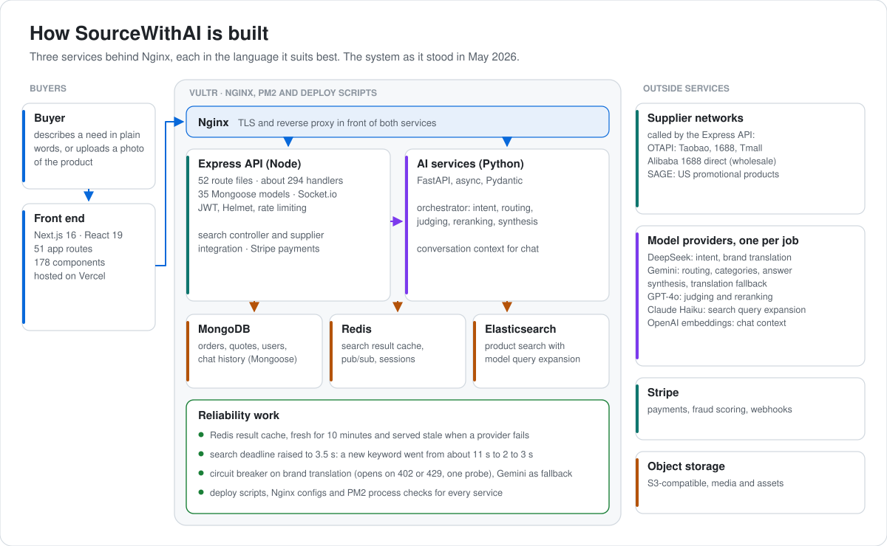
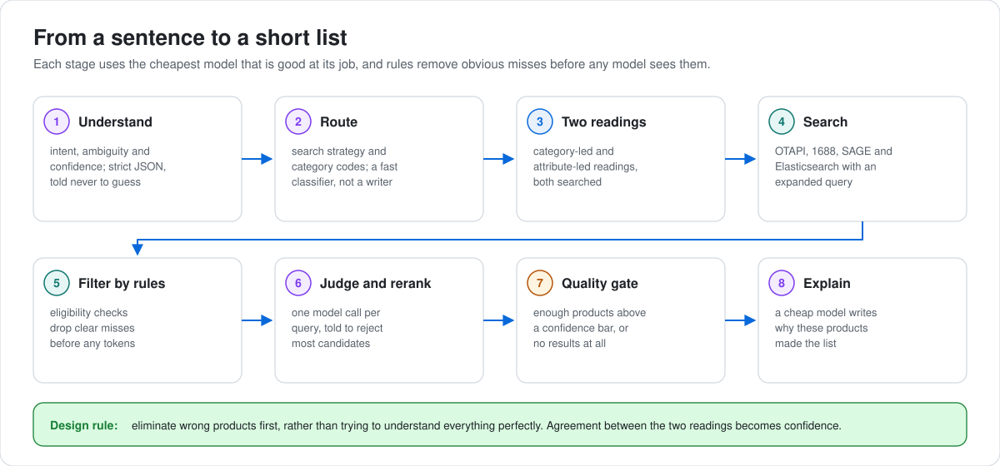

# SourceWithAI, AI-powered B2B sourcing platform

> **Live at [sourcewithai.com](https://sourcewithai.com)** · I led its technology until May 2026 · Private commercial repository, architecture shared here for portfolio purposes

            

SourceWithAI is a production B2B sourcing platform. Buyers describe what they need in plain language, and the system works out what they actually mean, searches multiple supplier networks, filters aggressively, and returns a short list of products it can justify.

The interesting engineering problem is not the chat interface. It is that supplier marketplace search APIs return large volumes of loosely relevant results, so the platform is built to **treat those APIs as raw data sources rather than as search engines**, and to do the ranking, filtering and judgement itself.

---

## Architecture

Three services behind Nginx, split by what each one is good at.

<picture>
  <source media="(prefers-color-scheme: dark)" srcset="assets/architecture-dark.svg">
  
</picture>

**Why three services.** The AI layer is Python native, the transactional and real-time layer is better in Node, and separating them means the AI service can be redeployed or restarted without touching checkout.

---

## The search pipeline

The core of the product. A naive implementation sends the user's words to a supplier API and shows what comes back, which produces poor results because those APIs match on keywords rather than intent.

Instead, search runs through a staged pipeline with a deliberate division of labour across models, each chosen for what it is good at rather than for being the strongest available.

<picture>
  <source media="(prefers-color-scheme: dark)" srcset="assets/search-pipeline-dark.svg">
  
</picture>

| Stage | Role | Why this model class |
|---|---|---|
| **Intent reasoning** | Understand the request, detect ambiguity, list possible meanings, score confidence | Fast and cheap, excellent at classification. Returns strict JSON and is instructed never to guess |
| **Routing and category selection** | Decide search strategy, pick category codes, exclude irrelevant categories | Very fast and deterministic. Used as a classifier, not a creative model |
| **Judgement and reranking** | Reject irrelevant products, rank the rest, score fit, explain the choice | Best buyer-style reasoning. Exactly **one call per query**, and it does no searching or routing |
| **Response synthesis** | Explain the result set back to the user | Cheap and fast, no reasoning burden |

**Dual-reality retrieval.** Rather than committing to one interpretation of an ambiguous request, the pipeline forks intent into two readings, one category-dominant and one attribute-dominant, runs both, then intersects them. Agreement between the two paths becomes a confidence signal. A deterministic eligibility filter runs before any model judgement, so obviously wrong products are eliminated by rules rather than by tokens. A final quality gate requires a minimum number of products above a confidence threshold before results are returned at all.

The design principle behind it: **eliminate wrong products first rather than trying to understand everything perfectly.**

---

## Retrieval and ranking

- **Elasticsearch** for product search, with AI-expanded queries so synonyms, variants and related terms are folded in before the query runs
- **Object detection** (DETR via transformers.js) for image search, so a buyer can upload a photo and have the product identified before searching
- **Redis** result cache: fresh for 10 minutes, and served stale when a supplier network fails, so a transient timeout does not empty the page
- **Deadlines and fallbacks**: a 3.5 second search deadline, and a circuit breaker on brand translation (DeepSeek) that falls back to Gemini
- Cross-network deduplication and unified ranking, since the same physical product appears under different titles, currencies and minimum order conventions depending on the source

**Supplier networks integrated:** OTAPI fronting the Alibaba ecosystem (Taobao, 1688, Tmall), Alibaba 1688 direct for wholesale and Fenxiao, and SAGE for the US promotional products market. Each has a different schema, currency handling and minimum order convention, so normalising them into one catalogue was a larger job than the retrieval layer itself.

---

## Supplier intelligence

Beyond search, the platform maintains a view of the supplier side.

- Premium vendor scoring from reviews, certifications and order history
- Supplier snapshots on a schedule, with change alerts
- Competitor and cross-network price comparison
- Minimum-order-quantity splitting across suppliers
- Trending keyword and market signal tracking
- Configurable product boost rules for merchandising

---

## Commerce and B2B workflow

- Conversational sourcing sessions with multi-turn refinement and persisted context
- Request for quote workflow with admin approval and expiry handling
- Cart and checkout for both guest and authenticated buyers, with product configuration and customisation
- Stripe payments with fraud risk scoring and webhook handling
- Wholesale and direct-supplier order flows
- Order tracking, reviews, support tickets, bundles, coupons and a points system
- Product mockup generation for client previews, and automated deck rendering
- Automatic translation of supplier product data
- Notion sync for orders, quotes and trending data
- Admin dashboard with analytics, user management and configuration

---

## Stack

| Layer | Technologies |
|---|---|
| **Frontend** | Next.js 16, React 19, Tailwind, Framer Motion, GSAP, Three.js, Spline, Radix UI, TipTap, Recharts, SWR |
| **API** | Express, Socket.io, Mongoose, JWT and OAuth, Helmet, rate limiting, Swagger |
| **AI services** | Python FastAPI (async, Pydantic), one model per job across DeepSeek, Google, OpenAI and Anthropic |
| **Search** | Elasticsearch with model query expansion, transformers.js (DETR) for image search |
| **Data** | MongoDB, Redis, S3-compatible object storage |
| **Media** | Sharp, HEIC conversion, Fabric.js, Puppeteer for server-side rendering |
| **Payments** | Stripe |
| **Ops** | Vercel (front end), Vultr (API and AI services), Nginx, PM2, deploy scripts, health checks for Elasticsearch and Redis |

---

## Scale

| | |
|---|---|
| API route files | 52 |
| Mounted API domains | 47 |
| Route handlers | 294 |
| Backend services | 61 |
| Data models | 35 |
| Frontend routes | 51 |
| React components | 178 |

---

## My role

I led the platform's technology until May 2026, with two developers on the team working under my direction. What I personally built:

- **Search**: the search controller and the supplier integration with OTAPI, the core of how a request becomes products
- **The Python AI services**: the FastAPI AI service and the orchestrator behind intent, routing, judging, reranking and synthesis
- **Reliability**: the Redis serve-stale result cache, the search deadline fix (a new keyword went from about 11 seconds to 2 to 3), the circuit breaker and Gemini fallback on brand translation, and the fixes that followed production errors
- **Deployment**: the deploy scripts, Nginx configs and PM2 setup on Vultr
- **A search benchmark**: on two 100-keyword developer benchmarks, the share of searches returning products went from 76 to 99 percent. It is a smoke benchmark scored by keyword match, not a labelled evaluation.

The Express routes, data models and most of the front end were written by the team under my direction.

---

## Status

**Live** at [sourcewithai.com](https://sourcewithai.com). My role on the platform ended in May 2026, and this page describes the system as it stood then.

> Private commercial repository. Source is not public. Architecture and technical approach are documented here for portfolio purposes; a code walkthrough is available on request during interviews.
